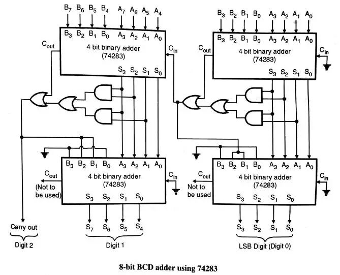
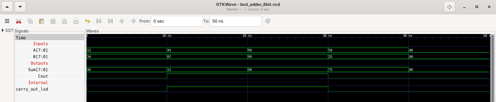
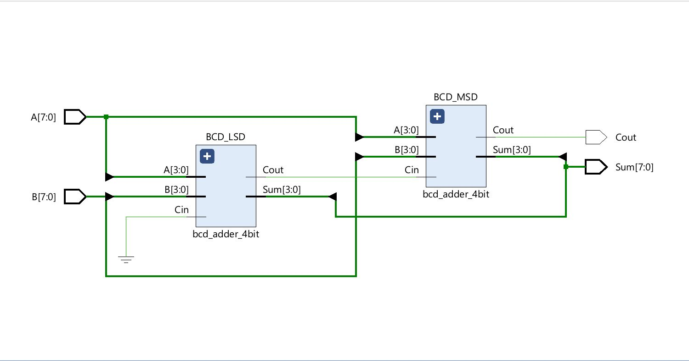
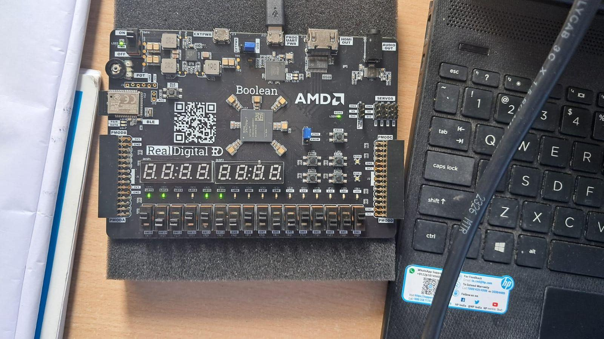

# 8-bit BCD Adder

A digital circuit that adds two 8-bit Binary Coded Decimal (BCD) numbers. It is designed in Verilog HDL, simulated with Icarus Verilog and GTKWave, and implemented on an FPGA board.

**Team:** Harikrishnan T.N · Sona Jolly

## Introduction

BCD represents each decimal digit with its own 4-bit binary code. Each digit ranges from 0 to 9 (0000 to 1001 in binary).

Example: BCD(213) = 0010 0001 0011

When two BCD digits are added and the sum is greater than 9, **6 (0110)** is added to bring the result back into valid BCD format, and a carry is passed to the next digit.

## Definition / Aim

**Definition:** An 8-bit BCD adder adds two 8-bit BCD numbers. The sum of each 4-bit digit is corrected if it exceeds 9, producing a valid BCD result with carry propagation.

**Aim:** To design, simulate and synthesize an 8-bit BCD adder using Verilog HDL, and to demonstrate its working through hardware and software tools.

## Scope

1. Designing an 8-bit BCD adder in Verilog.
2. Simulating the design using Icarus Verilog and GTKWave.
3. Synthesis and implementation of the design on hardware.
4. Producing accurate results for BCD addition with proper carry propagation.

## Block Diagram



*8-bit BCD adder using 74283 4-bit binary adders*

## Verilog Design

The design is made of two modules:

- **`bcd_adder_4bit`** adds two BCD digits and a carry-in. If the binary sum is greater than 9, it adds 6 to correct the result and sets the carry-out.
- **`bcd_adder_8bit`** connects two `bcd_adder_4bit` blocks. `BCD_LSD` adds the lower digits (carry-in = 0), and its carry-out feeds `BCD_MSD`, which adds the upper digits.

```
rtl/
  bcd_adder_4bit.v       single-digit BCD adder
  bcd_adder_8bit.v       8-bit BCD adder (top module)
tb/
  tb_bcd_adder_8bit.v    testbench
sim/
  bcd_adder_8bit.vcd     waveform dump
  bcd_adder_8bit.gtkw    GTKWave signal layout
  simulation_log.txt     simulation output
docs/images/             diagrams, waveform and FPGA photo
```

## Simulation

Run with Icarus Verilog and open the waveform in GTKWave:

```bash
cd sim
iverilog -o bcd_adder_8bit.vvp ../rtl/bcd_adder_4bit.v ../rtl/bcd_adder_8bit.v ../tb/tb_bcd_adder_8bit.v
vvp -n bcd_adder_8bit.vvp
gtkwave bcd_adder_8bit.gtkw
```

### Waveform (GTKWave)



### Test results

| Time (ns) | A | B | Sum | Cout | Result |
|---:|:--:|:--:|:--:|:--:|---|
| 10 | 12 | 34 | 46 | 0 | 12 + 34 = 46 |
| 20 | 45 | 67 | 12 | 1 | 45 + 67 = 112 |
| 30 | 99 | 99 | 98 | 1 | 99 + 99 = 198 |
| 40 | 50 | 25 | 75 | 0 | 50 + 25 = 75 |
| 50 | 00 | 00 | 00 | 0 | 0 + 0 = 0 |

Simulation output (`sim/simulation_log.txt`):

```
Time	A		B		Sum		Cout
10	00010010	00110100	01000110	0
20	01000101	01100111	00010010	1
30	10011001	10011001	10011000	1
40	01010000	00100101	01110101	0
50	00000000	00000000	00000000	0
```

## Schematic Diagram



## Hardware and Software Requirements

**Software tools**
- Icarus Verilog – simulation and testing of the design
- GTKWave – waveform viewer for the simulation results

**Hardware tools**
- FPGA board for synthesizing and testing the design

## FPGA Implementation



BCD(99) + BCD(99) = BCD(198) ⇒ **1 1001 1000**

## Conclusion

- The 8-bit BCD adder was implemented in Verilog and deployed on an FPGA board.
- It performs accurate decimal addition in BCD format.
- Sums greater than 9 are corrected reliably, and the carry propagates correctly between digits.

## References

1. Digital Design, 4th edition – M. Morris Mano and Michael D. Ciletti
2. BCD Arithmetic Logic Units Design Manual
3. Verilog HDL for Digital Design – Simulation and Synthesis Guidelines
4. Digital Design and Computer Architecture – David M. Harris and Sarah L. Harris
